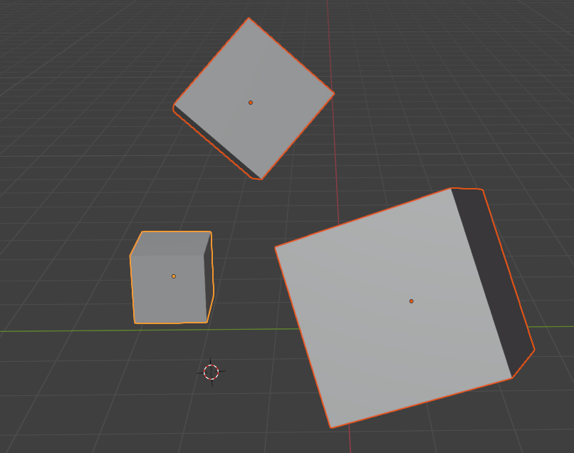

## Final Live Code

<!-- <iframe src="https://openprocessing.org/sketch/2596343/embed/?plusEmbedHash=898e24b8&userID=410675&plusEmbedTitle=true&show=sketch" width="600" height="600"></iframe> -->

## Final Result - Video

<!--  -->

## Summary

## WCCChallenge Blurb

| Biz             | Biz Biz                                             |
|:--------           | :---------                                       |
| Author          | Project Somedays                                    |
| Title           | WCCChallenge 2025 Week 12 - Morph with Quadtree     |
| 📅 Started      | 2026-11-22                                         |
| 📅 Completed    | 2026-11-22                                         |
| 🕒 Taken        | ~6hrs                                              |
| 🤯 Concept      | What's the story?                                  | 
| 🔎 Focus        | What's the technical focus?                        |
| 🤖 AI-use       | PoissonDarts                                       |
| 📔 Write-up     | https://project-somedays.github.io/                |

Made for Sableraph's weekly creative coding challenges, reviewed weekly on [https://www.twitch.tv/sableraph](https://www.twitch.tv/sableraph)

See other submissions here: [https://openprocessing.org/curation/78544](https://openprocessing.org/curation/78544)

Join The Birb's Nest Discord community! [https://discord.gg/g5J6Ajx9Am](https://discord.gg/g5J6Ajx9Am)

### 📃THE ALGORITHM📃

- Scatter rocks around but not too close 👉
- Use Matter.js to handle the interactions with the rocks
- Use a collision filter to make the particles ignore each other

### 🎓Lessons Learned🎓

- Item 1

### Resources

- "Typewriter" by Metro on Sketchfab: [https://sketchfab.com/3d-models/typewriter-c212b517cbdd4fa1930ed31a45670d39](https://sketchfab.com/3d-models/typewriter-c212b517cbdd4fa1930ed31a45670d39)

### Stretch Goals/Extension Ideas
- [ ] Swirl the parts around artistically with open simplex noise
- [ ] Look at a bunch of different machines that would be cool to explode
- [ ] Explode extent controls

### TODO:
- [ ] To do

## 🪵Dev Log🪵

### 2025-03-29 Threejs exploded view
  - Item 1  
  
